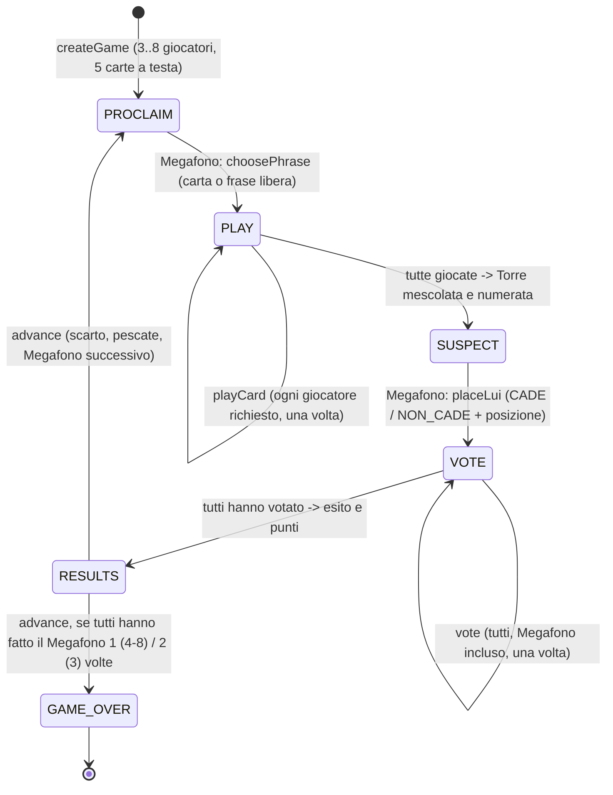

# GAME_FLOW — macchina a stati del motore (`packages/game-engine`)

Il server è l'unica autorità: il client invia **azioni**, il motore le valida e produce un nuovo stato + eventi.

| Fase | Chi agisce | Azione | Transizione |
|---|---|---|---|
| PROCLAIM | Megafono | `choosePhrase` (`card`+indice, oppure `free`) | PLAY; in modalità base pesca la carta dal mazzo per la Torre |
| PLAY | Folla (+ Megafono se "Megafono sa") | `playCard` | SUSPECT quando tutti hanno giocato |
| SUSPECT | Megafono | `placeLui` | VOTE |
| VOTE | tutti | `vote` | RESULTS quando tutti hanno votato |
| RESULTS | server / chiunque | `advance` | PROCLAIM o GAME_OVER |

Errori tipizzati (`EngineError`): WRONG_PHASE, NOT_ALLOWED, ALREADY_DONE (doppio invio/voto), CARD_NOT_IN_HAND, INVALID_POSITION, INVALID_CHOICE, UNKNOWN_PLAYER, GAME_OVER, DECK_EXHAUSTED.

Eventi trasversali gestiti dal backend (non dal motore): disconnessione/riconnessione, espulsione in lobby, timeout (il server può usare `suggestAction` per giocare al posto di un inattivo).
