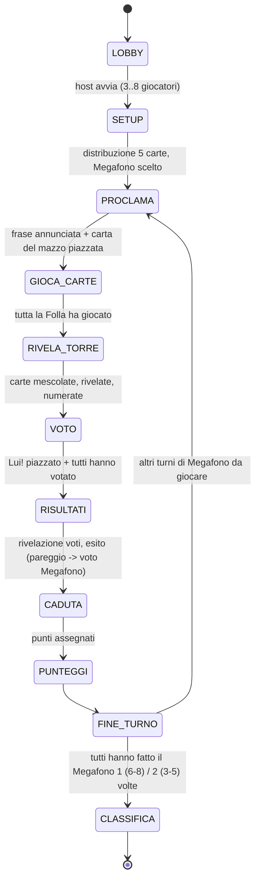

# GAME_FLOW — fasi e transizioni (provvisorio, rev. 5.2l)

Eventi di sistema trasversali: disconnessione/riconnessione (la fase attende o applica timeout — da decidere, vedi `ARCHITECTURE.md`), espulsione (solo in LOBBY), abbandono stanza inattiva.
