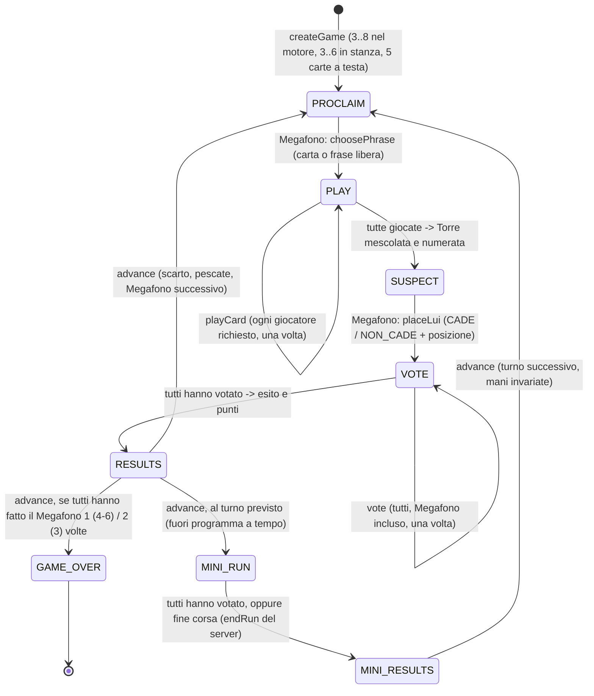

# GAME_FLOW — macchina a stati del motore (`packages/game-engine`)

Il server è l'unica autorità: il client invia **azioni**, il motore le valida e produce un nuovo stato + eventi.

| Fase | Chi agisce | Azione | Transizione |
|---|---|---|---|
| PROCLAIM | Megafono | `choosePhrase` (`card`+indice, oppure `free`) | PLAY; in modalità base pesca la carta dal mazzo per la Torre |
| PLAY | Folla (+ Megafono se "Megafono sa") | `playCard` | SUSPECT quando tutti hanno giocato |
| SUSPECT | Megafono | `placeLui` | VOTE |
| VOTE | tutti | `vote` | RESULTS quando tutti hanno votato |
| RESULTS | server / chiunque | `advance` | PROCLAIM o GAME_OVER |
| MINI_RUN | tutti, a tempo | `vote` (un personaggio in scena); il server fa `endRun` a fine corsa | MINI_RESULTS (anche prima, se hanno votato tutti) |
| MINI_RESULTS | server / host | `advance` | PROCLAIM del turno successivo (le mani non cambiano) |

Errori tipizzati (`EngineError`): WRONG_PHASE, NOT_ALLOWED, ALREADY_DONE (doppio invio/voto), CARD_NOT_IN_HAND, INVALID_POSITION, INVALID_CHOICE, UNKNOWN_PLAYER, GAME_OVER, DECK_EXHAUSTED.

Eventi trasversali gestiti dal backend (non dal motore): disconnessione/riconnessione, espulsione in lobby, timeout (il server può usare `suggestAction` per giocare al posto di un inattivo).

## Creazione della partita (wizard a 3 passi)
1. **Chi sei?** Nickname e personaggio (carte con segnalino da scorrere col dito; quella al centro è la scelta).
2. **Come giocate?** Stesso tavolo / A distanza, bot (numero e livello).
3. **Ultimi dettagli.** Pubblico (6/10/14/18) e timer (libero, 30–120 s), riepilogo e «Crea partita».
Il personaggio, il pubblico e il timer viaggiano nella richiesta di creazione (`char`, `ageBand`, `turnTimerSec`); nella lobby sono solo mostrati. Gli altri giocatori ricevono un personaggio libero a caso. «Il Megafono sa» è sempre attivo (la creazione manda `megafonoSa: true`).
